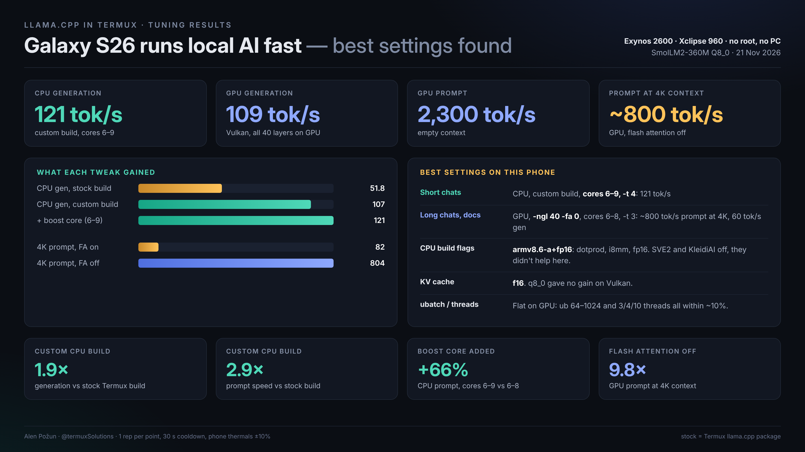

# llama.cpp tuning on Galaxy S26

llama.cpp builds, flags and settings measured on a Samsung Galaxy S26 (Exynos 2600, Xclipse 960 GPU) in Termux, with no root and no PC. It covers custom CPU builds against the stock package, Vulkan offload, core pinning, thread counts and flash attention, with the scripts used for every measurement.

All measurements and recommended settings: [RESULTS.md](RESULTS.md). Scripts: [scripts/](scripts/).

Author: Alen Požun ([@termuxSolutions](https://x.com/termuxSolutions)), built with AI assistance
